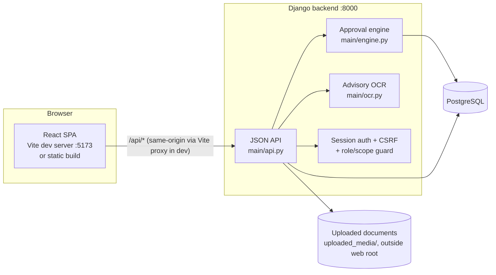

# LNMIIT No-Dues Portal

A web application that digitizes LNMIIT's student clearance ("No Dues") process: a student initiates an exit request, every institutional section (Library, Warden, HOD, Accounts, Administration, …) independently approves or rejects with a mandatory reason, and the student downloads a final No-Dues certificate once every section is green.

Department labs replace the paper "No Dues Form for Department Purpose": each department's HOD registers its labs in the portal (which creates each lab in-charge's login) and arranges them in levels. A student sends their request to the labs level by level — labs on the same level review it together, the next level opens only when every lab on the current one approves — and the HOD approves last.

The Library, LUCS, NAD Cell and Administration desks can be shared. Every request reaches the section's own account first (`library@`, `lucs@`, `nad@` or `admin.office@`). That account adds staff, each with their own login, and sends them requests, either "the next 35" in one go or one at a time. Staff see only what's sent to them, and their approve or reject is final.

Accounts staff work in **levels** instead, set by `accounts@`. A ready request goes to level 1 automatically, then to level 2 once level 1 approves, and so on. When two people share a level, either one can approve. After the last level, every request comes to `accounts@` itself: it is always the **final step**, and its approval approves Accounts.

Accounts and **Administration run side by side**. Once Library, Warden and HOD approve (and TPC, for a graduation), both open together, side by side on the student's Page 4 (Financial & Administration); Page 5 is the certificate. The student also sets their optional **Fund-Us donation** on Page 4, beside the Refund Ledger. It comes out of the ₹10,000 caution money and can change until Accounts approves. Each exit type has its own dependency graph: NEP exits, withdrawals and admission cancels have no TPC step, so nothing waits for one. When Django starts, a check runs Kahn's algorithm over every exit type's graph and refuses to start if a section waits for one the exit type doesn't have, or if there is a cycle. Administration's staff work by hand, like LUCS and NAD: `admin.office@` sends them requests. It also has an **office checklist**, starting with "Physical ID card submitted": its office ticks each item when the student hands it in, and Administration can't approve until everything is ticked.

Once **every** section has approved, Accounts **sends the student's refund** and records it in the **Refund** column of its **Approved** tab (amount, mode, UTR / transaction reference, date). `accounts@` is always the **refund manager** and does this, and so can any staff member it also marks as one (**Edit** on their card). Their Approved tab lists every request Accounts has approved and shows how many refunds are waiting ("· 2 to send"). Each row has three actions: **Mark refund sent**, **No refund due**, or **Reject** with a reason (e.g. the bank details are wrong), which sends Accounts back to the student. Only once the refund is recorded is the clearance complete. The student sees "Your refund of ₹… has been sent …" on their dashboard and in their Accounts messages, and the No-Dues certificate, which shows the refund, unlocks.

- **Frontend:** React 18 + TypeScript + Vite (`frontend/`)
- **Backend:** Django (`No-Dues-Portal/`), session auth, JSON API
- **Database:** PostgreSQL — the only supported database (`docker-compose.yml`, or any `DATABASE_URL`) — see [docs/SCALING.md](./docs/SCALING.md)

> **New here?** Read this file top to bottom, then go to [`docs/`](./docs) for the deep-dive (architecture, API reference, data model, and the production/scaling plan).

---

## Table of contents

1. [Architecture](#architecture)
2. [Repository layout](#repository-layout)
3. [Quickstart](#quickstart)
4. [Docker Compose quickstart (PostgreSQL, production-shaped)](#docker-compose-quickstart-postgresql-production-shaped)
5. [Demo logins](#demo-logins)
6. [Documentation map](#documentation-map)
7. [Scaling & handling heavy traffic](#scaling--handling-heavy-traffic)

---

## Architecture



**Why same-origin, not CORS:** in development, Vite proxies every `/api/*` request from `localhost:5173` to Django on `127.0.0.1:8000` (`frontend/vite.config.ts`). The browser never sees a cross-origin request, so Django's default session-cookie + CSRF-cookie auth works with no CORS configuration. In production, the two are typically served behind the same reverse-proxy host (nginx) — see [docs/SCALING.md](./docs/SCALING.md).

For the full request lifecycle (login, approval, reverse cascade, certificate) see [docs/ARCHITECTURE.md](./docs/ARCHITECTURE.md). For the section dependency graph and state machine, see [docs/DESIGN.md](./docs/DESIGN.md#approval-engine).

## Repository layout

```
.
├── docker-compose.yml             Postgres + gunicorn + nginx stack (see Docker Compose quickstart)
├── .env.example                    Template for docker-compose.yml's environment
│
├── frontend/                      React + TypeScript + Vite SPA
│   ├── Dockerfile                   Multi-stage: npm build -> nginx serve
│   ├── nginx.conf.template           Serves the SPA, proxies /api, /admin, /static to Django
│   │                                 (BACKEND_HOST/BACKEND_PORT/PORT are env-driven — see docs/DEPLOY.md)
│   └── src/
│       ├── api.ts                     Typed API client (fetch + CSRF handling)
│       ├── types.ts                    Types matching the Django API
│       ├── App.tsx                     Session restore, role-based routing
│       ├── pages/                      LoginPage, StudentDashboard, SectionApprovalPage, ...
│       └── components/Layout.tsx
│
├── No-Dues-Portal/                 Django backend
│   ├── Dockerfile                    gunicorn image (installs Tesseract for OCR)
│   ├── docker-entrypoint.sh           Waits for the DB, runs migrations, then execs gunicorn
│   ├── myproject/settings.py          Env-driven secret/debug/hosts/database (see below)
│   └── main/
│       ├── models.py                    Data model
│       ├── engine.py                    Approval engine: gating + reverse cascade (sections and department labs)
│       ├── labs.py                      HOD "Manage Labs": add/edit/remove labs + their in-charge logins
│       ├── staff.py                     Section staff: send by hand (Library, LUCS, NAD Cell) or by level (Accounts); add/remove staff
│       ├── accounts.py                  Shared login creation/validation for lab in-charges and staff
│       ├── api.py                       JSON API views
│       ├── tests.py                     Department-lab + section-staff tests (`python manage.py test main`)
│       ├── ocr.py                       Advisory OCR (Tesseract via pytesseract)
│       ├── urls.py
│       └── management/commands/seed_demo.py   Demo data seeding
│
├── docs/                           All deep-dive documentation (the "creator docs")
│   ├── DESIGN.md                     Domain design: section flow, approval engine, correctness properties
│   ├── ARCHITECTURE.md               What's actually running: request lifecycle, sequence diagrams
│   ├── API.md                        Every JSON API endpoint
│   ├── DATA_MODEL.md                 ER diagram + field-by-field notes
│   ├── SCALING.md                    Production readiness + load testing plan
│   ├── DEPLOY.md                     Deploying to Railway (+ alternatives) step by step
│   ├── loadtest/locustfile.py        Ready-to-run load test
│   └── images/
│
└── LNMIIT_No_Dues_Portal_Research_Document.md   Research behind the section list & design choices
```

## Quickstart

Requires Python 3.10+, Node 18+, [Docker](https://docs.docker.com/get-docker/) (used here just to run PostgreSQL — see below), and (optionally, for OCR) the Tesseract OCR engine installed at the OS level.

PostgreSQL is the only supported database — there's no SQLite fallback. The quickest way to get one locally without a native install is to start just the `db` service from the bundled `docker-compose.yml`:

```bash
cp .env.example .env    # defaults are fine for local dev — just needs to exist
docker compose up -d db
```

> **Port 5432 already in use?** Some machines already run a local Postgres install on that port (or another Docker project does). Set `POSTGRES_PORT=<something free, e.g. 55432>` in `.env` — `docker compose up -d db` and the steps below both pick it up automatically, nothing else to change.

**1. Backend (Django) — Terminal 1**

```bash
cd No-Dues-Portal
python -m venv .venv && .venv\Scripts\activate      # Windows; use `source .venv/bin/activate` on macOS/Linux
pip install -r requirements.txt
python manage.py migrate
python manage.py seed_demo                            # creates demo users/students/sections
python manage.py runserver 8000
```

No `DATABASE_URL` to export by hand: `myproject/settings.py` loads the repo-root `.env` automatically (`python-dotenv`) and, if `DATABASE_URL` itself isn't set, builds one from `.env`'s `POSTGRES_*` values against `localhost` — the same credentials `docker compose up -d db` above just started listening with. Change `POSTGRES_PASSWORD`/`POSTGRES_PORT` in `.env` and both the container and `manage.py` stay in sync automatically — there's only one place to edit.

**2. Frontend (React) — Terminal 2**

```bash
cd frontend
npm install
npm run dev
```

Open **http://localhost:5173**. The Vite dev server proxies `/api/*` to Django on port 8000 — you do not open port 8000 directly except for `/admin`.

**3. Reset demo data at any time**

```bash
python manage.py seed_demo --reset
```

For why no CORS setup is needed (the Vite proxy makes every `/api/*` call same-origin), see [Architecture](#architecture) above or the full request lifecycle in [docs/ARCHITECTURE.md](./docs/ARCHITECTURE.md).

## Docker Compose quickstart (PostgreSQL, production-shaped)

The setup above still runs Django and Vite directly on your machine (just Postgres in a container). For anything closer to production — or to avoid running Python/Node locally at all — `docker-compose.yml` at the repo root runs the *whole* stack: PostgreSQL, Django under gunicorn, and the built React SPA served by nginx (which also proxies `/api`, `/admin`, and `/static` to Django, the same same-origin trick the Vite dev proxy does).

```bash
cp .env.example .env
# edit .env: set a real DJANGO_SECRET_KEY and POSTGRES_PASSWORD (comments in the file explain each value)

docker compose up --build

# first run only — creates demo users/students/sections against the Postgres DB
docker compose exec backend python manage.py seed_demo
```

Open **`http://localhost`** (or whatever `HTTP_PORT` you set in `.env`). Django admin is at `http://localhost/admin`.

This is also the setup to point [`docs/loadtest/locustfile.py`](./docs/loadtest/locustfile.py) at before trusting the portal with a real clearance window — see [Scaling & handling heavy traffic](#scaling--handling-heavy-traffic) below and [docs/SCALING.md](./docs/SCALING.md) for the full picture (what gunicorn/nginx/Postgres buys you, and what's still not included — e.g. TLS termination, a real domain, CI/CD).

**Verified working end to end** (not just written): all three containers build and start healthy, `/`, `/api/csrf/`, and `/admin/` all respond correctly through nginx, and a full login (`POST /api/login/` with CSRF) succeeds against the containerized Postgres.

**Ready to put this somewhere reachable?** `frontend/nginx.conf.template` and both Dockerfiles are already parameterized for that — `BACKEND_HOST`/`BACKEND_PORT` (where nginx finds Django) and `PORT` (what port nginx itself listens on, matching whatever a given platform injects) are all environment-driven, not hardcoded. **[docs/DEPLOY.md](./docs/DEPLOY.md)** walks through deploying this exact setup to Railway step by step (managed Postgres + a private backend + a public frontend, over Railway's private networking — no CORS needed, same as here), plus notes for Render/Fly.io/a plain VPS, and how to load-test a real deployment without surprising your hosting bill or the students actually using it.

## Demo logins

Password for every account: **`csepassword`**.

| Role | Login (webmail) |
|---|---|
| Student | `student@` · `amit@` (CSE, BH1) · `priya@` (ECE, GH1) · `arjun@` (CCE, BH2) `lnmiit.ac.in` |
| Library / TPC / Store / LUCS / Sports / Medical / NAD | `library@` · `tpc@` · `store@` · `lucs@` · `sports@` · `medical@` · `nad@ lnmiit.ac.in` |
| HOD (one per department) | `hod.cse@` · `hod.cce@` · `hod.ece@` · `hod.mme@ lnmiit.ac.in` |
| Lab In-charge (ECE labs) | level 1: `microwave.lab@` · `adc.lab@` · `ti.lab@` — level 2: `dsp.lab@` — level 3: `ecad.lab@` · `be.lab@ lnmiit.ac.in` |
| Section staff (same User Type as their head) | Library (`library@`): `lib.staff1@` · `lib.staff2@` — LUCS (`lucs@`): `lucs.staff1@` · `lucs.staff2@` — NAD Cell (`nad@`): `nad.staff1@` · `nad.staff2@ lnmiit.ac.in` |
| Accounts staff by level (User Type: Accounts; set by `accounts@`) | level 1: `acc.staff1@` — level 2: `acc.staff2@` · `acc.staff3@` (either can approve) — level 3: `acc.staff4@ lnmiit.ac.in` |
| Warden (per hostel) | `warden.bh1@` · `warden.gh1@ lnmiit.ac.in` |
| Accounts | `accounts@lnmiit.ac.in` |
| Administration | `admin.office@lnmiit.ac.in` |
| Django admin | `admin` at http://127.0.0.1:8000/admin |

Because of the hierarchy, Accounts/Administration queues start empty until their prerequisite sections clear — start with Store, Sports, Medical, NAD, HOD, or a Warden account to see requests immediately (HOD is independent of the other sections).

**Department labs demo (ECE).** The seed gives ECE six labs, taken from the paper department form. CSE, CCE and MME get no labs, so their HODs work exactly as before. To walk through the lab chain:

1. Sign in as `priya@` (ECE). Submit Page 1, then approve her as `library@`, `tpc@` and `warden.gh1@`.
2. Back as `priya@`, open the **HOD / Department** card on Page 3 and send the request to Level 1.
3. Sign in as each lab with user type **Lab In-charge** to approve, or to reject with a reason.
4. Repeat steps 2 and 3 for each level.
5. Sign in as `hod.ece@`: the request moves from **In labs** to **Incoming** once every lab approves.

The same HOD account's **Manage labs** tab adds, edits, re-levels and removes labs. Adding a lab creates its in-charge's login. ECE HOD approvals are blocked until every lab in the student's chain has approved.

**Section staff demo (Library, LUCS, NAD Cell).**

1. Run `python manage.py seed_demo --demo-requests 40`. It adds 40 demo students, `demo001@` to `demo040@`, whose requests are waiting at the Library, LUCS and NAD Cell. For LUCS and NAD, they've already clicked "Confirm & Send".
2. Sign in as `library@` (User Type: Library). In **Incoming**, use **Send the next [35] waiting requests to [Library Assistant 1]**. Each row's **Handled by** menu moves a single request, or takes it back.
3. Sign in as `lib.staff1@` (also User Type: Library). You'll see only those 35, and your approve or reject is final.

LUCS works the same way with `lucs@` and `lucs.staff1@` (User Type: LUCS), and so does NAD with `nad@` and `nad.staff1@` (User Type: NAD Cell). For these two confirm-only sections, a request counts as waiting only once the student has clicked "Confirm & Send" for that section.

Each head's **Manage staff** tab adds, edits, resets passwords for, and removes its own staff. A removed staff member's waiting requests go back to the head. Staff never see that tab.

**Accounts levels demo.**

1. Run `python manage.py seed_demo --demo-accounts 10`. It adds 10 demo students, `acct001@` to `acct010@`, whose requests have already reached Accounts and Administration: Library, TPC, Warden and HOD have approved, the cheque details are submitted, and the Administration details on Page 4 are confirmed.
2. Sign in with User Type **Accounts**, first as `acc.staff1@` (level 1). Approve a request, and it moves to level 2 by itself.
3. There, `acc.staff2@` or `acc.staff3@` can approve it. Once one of them does, it leaves both their lists.
4. `acc.staff4@` (level 3) approves it, and it goes to `accounts@`.
5. `accounts@` gives the final approval: in **Incoming**, pick **Show → With you · final approval**.

`accounts@` sets the levels in **Manage staff** and sees every request's stage, for example "Level 2 of 3" or "With you · final approval". Its **Show** filter lists "With you · final approval", every configured level ("At Level 1", "At Level 2", …) and "Not ready yet". Manage staff shows the chain with `accounts@` fixed at the end as the final approval and refund manager; there is no button to move it.

`accounts@` has an **Approve** button on every row. After every level has approved, that is its final approval. Before that, it approves the level the request is at, standing in for the people on it, and moves the request up one level; at the last level, it's also the final approval. Rows that are **Not ready yet** show it greyed out, along with what they're waiting for: "Waiting for Library, TPC, Warden, HOD", or the student's cheque details. `accounts@` can also send any request back with Reject. If a level rejects, the student fixes the problem and the request goes back to that same level; earlier levels' approvals are kept.

**Administration demo.** The same 10 requests are also waiting at Administration, which runs alongside Accounts.

1. Sign in with User Type **Administration** as `admin.office@`. It works like `lucs@` / `nad@`: in **Incoming**, send the next N waiting requests to `admin.staff1@` or `admin.staff2@`, or one at a time with **Handled by**. Only requests whose Library, TPC, Warden and HOD have approved count as waiting.
2. Sign in as `admin.staff1@` (also User Type Administration). You see only what was sent to you. Approve is locked until you tick **Physical ID card submitted** in the Checklist column. Tick it, then approve; the decision is final.
3. Sign in as a student (`acct001@`, User Type Student). Page 4 shows the checklist ticked, beside Accounts.

`admin.office@` can also decide any request itself, and manages the checklist under **Manage staff → Checklist at the office**.

**Refund demo.**

1. Run `python manage.py seed_demo --demo-refunds 3`. It adds `refund001@` to `refund003@`, whose every section has approved. Their Page 5 says the certificate is waiting for Accounts to send the refund.
2. Sign in as `accounts@` (User Type Accounts), which always sends refunds. Open **Approved**. Each row's **Refund** column shows the student's bank account and the amount (₹10,000 less their Fund-Us donation). Enter the bank's UTR and click **Mark refund sent**, or **No refund due**, or **Reject** with a reason. Requests that other sections haven't finished show "Waiting for …" there, with the two pay buttons greyed out. A staff member `accounts@` marks as a refund manager gets the same Refund column in their own Approved tab.
3. Sign in as that student. A green banner says the refund was sent, with the UTR. Page 4's Refund Ledger shows it as paid, the Accounts messages have the note, and the certificate is ready to download, with the refund on it.

## Documentation map

Everything beyond this README lives in [`docs/`](./docs) — one folder, no scattered planning files at the repo root.

| Document | What it's for |
|---|---|
| [`docs/DESIGN.md`](./docs/DESIGN.md) | The domain design: section flow, approval engine, data model rules, correctness properties (P1–P12) |
| [`docs/ARCHITECTURE.md`](./docs/ARCHITECTURE.md) | What's actually running: request lifecycle, sequence diagrams, component responsibilities |
| [`docs/API.md`](./docs/API.md) | Every JSON API endpoint: method, auth, request/response shape |
| [`docs/DATA_MODEL.md`](./docs/DATA_MODEL.md) | ER diagram + field-by-field notes on every model |
| [`docs/SCALING.md`](./docs/SCALING.md) | Production readiness and handling high concurrent traffic (thousands of students) |
| [`docs/DEPLOY.md`](./docs/DEPLOY.md) | Deploying to Railway step by step (+ Render/Fly.io/VPS notes), and load-testing a real deployment safely |
| [`LNMIIT_No_Dues_Portal_Research_Document.md`](./LNMIIT_No_Dues_Portal_Research_Document.md) | Research behind the section list and design choices (kept at root — it's background research, not implementation reference) |

## Scaling & handling heavy traffic

The traffic pattern this has to survive is near-idle for most of the semester, then thousands of students logging in and refreshing their status inside the same few-day window before an exit deadline, with dozens of section officers polling their queues throughout. **[docs/SCALING.md](./docs/SCALING.md)** sets out the full plan and rationale; the essentials are below.

PostgreSQL is the only supported database — there is no SQLite fallback anywhere in the codebase, so development and production share the same concurrency semantics rather than diverging on the one behaviour that matters here (SQLite's single-writer file lock versus real concurrency control). `docker-compose.yml` provisions Postgres locally; outside Compose, `DATABASE_URL` points the application at any Postgres host and nothing else changes.

The application runs under gunicorn behind nginx, not `manage.py runserver`. `No-Dues-Portal/Dockerfile` starts three gunicorn workers, and nginx (`frontend/Dockerfile` + `nginx.conf`) serves the built SPA while proxying API, admin, and static traffic to them. The frontend bundle keeps jsPDF and html2canvas lazy-loaded, so the initial download stays around 210 KB.

Two items are deliberately still open. Database indexes on the columns officer queues filter by — `SectionStatus.status`, `request.is_active`, and the hostel and department foreign keys — have not been added yet; confirm the query plans with `EXPLAIN` under load and add them before a real rollout. Session storage is Django's DB-backed default, which is adequate for a single `backend` replica but should move behind a cache such as Redis or Memcached before scaling out with `docker compose up --scale backend=N`.

Load testing is prepared but not yet exercised: the Locust script at [`docs/loadtest/locustfile.py`](./docs/loadtest/locustfile.py) is ready and the Docker Compose stack is a valid target for it. Running it against a sized-up staging copy is the recommended next step before committing to a live clearance window.

---

*Questions? Start with the deep-dive docs in [`docs/`](./docs).*
