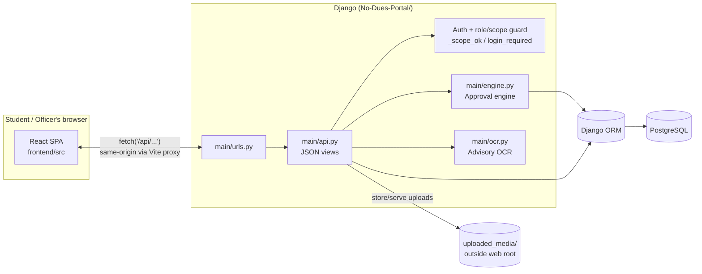
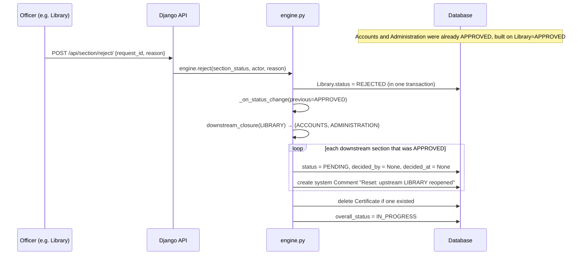

# Architecture

This describes the system as implemented — a decoupled React SPA talking to a Django JSON API — verified against the code (`No-Dues-Portal/main/*.py`, `frontend/src/*`). For the domain rules (why the section order is what it is, the correctness properties), see [`DESIGN.md`](./DESIGN.md).

## System overview



**Session auth, not tokens.** Django's built-in session framework (cookie-based) authenticates every request. The SPA never handles a JWT or bearer token. `GET /api/csrf/` sets the CSRF cookie before any `POST`; `src/api.ts::ensureCsrf()` fetches it automatically the first time a mutating request is made, then attaches it as the `X-CSRFToken` header, matching Django's default `CsrfViewMiddleware` expectations.

**Why the Vite proxy matters.** `frontend/vite.config.ts` proxies `/api/*` to `http://127.0.0.1:8000` in development. Because the browser only ever talks to `localhost:5173`, the session cookie set by Django is same-origin — no CORS headers, no `SameSite=None`, no cross-site cookie complications. In production this same property is achieved by putting both the built SPA and the Django app behind one reverse-proxy host (see [SCALING.md](./SCALING.md)).

## Request lifecycle: student clearance

```mermaid
sequenceDiagram
    actor S as Student
    participant SPA as React SPA
    participant API as Django API
    participant ENG as Approval engine
    participant DB as Database

    S->>SPA: Log in (webmail + password + role)
    SPA->>API: GET /api/csrf/
    SPA->>API: POST /api/login/
    API-->>SPA: {username, role, name}

    S->>SPA: Select exit type, vacated room
    SPA->>API: POST /api/student/initiate/
    API->>DB: create ClearanceRequest + one SectionStatus per required section
    API-->>SPA: request (PENDING everywhere)

    S->>SPA: Upload Library/TPC documents
    SPA->>API: POST /api/student/upload/ (multipart)
    API->>API: validate size/type
    API->>API: OCR (advisory, best-effort)
    API->>DB: create Document, attach OCR fields
    API-->>SPA: {warnings, autofill}

    S->>SPA: Submit intake (locks page 1)
    SPA->>API: POST /api/student/submit-intake/
    API->>DB: intake_submitted = True

    Note over API,DB: Library, TPC, Warden verify Page 1 (the tri-gate).<br/>Once all three approve, Store/LUCS/Sports/Medical/NAD/HOD<br/>get the request by themselves and work in parallel;<br/>Accounts + Administration once all six approve

    par Officer reviews
        actor O as Section officer
        O->>SPA: Open scoped queue
        SPA->>API: GET /api/section/queue/
        API->>DB: filter by section + hostel/dept scope
        O->>SPA: Approve / Reject (+reason)
        SPA->>API: POST /api/section/approve/ or /reject/
        API->>ENG: engine.approve() / engine.reject()
        ENG->>ENG: check actionable() (prerequisites APPROVED)
        ENG->>DB: update SectionStatus, write Comment (atomic)
        ENG->>ENG: recompute_overall()
    end

    Note over ENG,DB: HOD runs in parallel with Store/LUCS/Sports/Medical/NAD — after its department's labs, if any (next diagram).<br/>Accounts becomes actionable once Library+TPC+Warden+HOD clear.<br/>Administration once Accounts clears

    API-->>SPA: overall_status = CLEARED
    S->>SPA: Download certificate
    SPA->>API: POST /api/student/certificate/
    API-->>SPA: certificate JSON (student, sections, approvers, timestamps)
    SPA->>SPA: render off-screen HTML → html2canvas → jsPDF → save file
```

## Reverse-hierarchy cascade

The one property worth tracing end to end, since it's what makes the final certificate trustworthy:



All of this runs inside a single `transaction.atomic()` block (`engine.py::approve`/`reject`) — the matrix is never left half-updated if the process dies mid-cascade.

## Department lab chain

How a student clears their department's labs before HOD (rules: [DESIGN.md § Department labs](./DESIGN.md#department-labs-hod-managed-hierarchy)):

```mermaid
sequenceDiagram
    actor H as HOD
    actor S as Student
    actor L as Lab in-charge
    participant API as Django API
    participant ENG as engine.py
    participant DB as Database

    H->>API: POST /api/hod/labs/ {name, email, password, level}
    API->>DB: create User (role LAB) + Lab
    Note over S: Page 3 opens once Library/TPC/Warden approve
    S->>API: POST /api/student/labs/send/
    API->>ENG: send_next_lab_level()
    ENG->>DB: first send: one LabStatus per department lab (level copied); mark level 1 sent
    L->>API: GET /api/lab/queue/ → POST /api/lab/approve/ (or reject + reason)
    API->>ENG: approve_lab() — refused until every earlier level is APPROVED
    S->>API: POST /api/student/labs/send/ (next level, once the current one is all green)
    Note over S,DB: …repeat per level…
    H->>API: POST /api/section/approve/
    API->>ENG: approve(HOD) — refused (409) until every lab is APPROVED
```

If an approved lab later rejects, `engine._on_lab_status_change` resets the later-level labs and HOD to `PENDING`, then runs HOD's normal cascade (Accounts, Administration, certificate) — the same single transaction.

## Component responsibilities

| Component | File | Responsibility |
|---|---|---|
| Auth + role/scope guard | `main/api.py::_scope_ok`, `_profile`, `_lab_officer`, `_hod_department`, `@login_required` | Every state-changing view re-checks role AND hostel/department scope server-side — never trusts client-supplied role claims. A lab login's lab, and an HOD's department, always come from the session |
| Approval engine | `main/engine.py` | Owns `PREREQUISITES`, `actionable()`, `approve()`/`reject()`, `downstream_closure()`, `recompute_overall()` — and the department lab chain: `send_next_lab_level()`, `lab_actionable()`, `approve_lab()`/`reject_lab()`/`resend_lab()`, the lab cascade. Prerequisites are per exit type (`prerequisites(section, exit_type)`, `workflow(exit_type)`; TPC is optional), and `analyze_workflow()` validates each exit type's graph with Kahn's topological sort: missing dependencies and cycles |
| Workflow check | `main/checks.py` | Django system check `main.E001`: runs `engine.workflow_problems()` before `runserver` / `migrate` / `test`, so an invalid approval graph stops the app from starting |
| HOD lab management | `main/labs.py` | Add/edit/remove a department's labs; creates each in-charge's login (username = email, role `LAB`, Django password validators) |
| Section staff | `main/staff.py` | Staff of the Library, LUCS, NAD Cell, Accounts and Administration heads (`STAFF_SECTIONS`): who is head vs staff (`UserProfile.managed_by`); by hand (Library, LUCS, NAD Cell, Administration) — "send the next N" / move / take back (`SectionStatus.assigned_to`); by level (Accounts) — `current_level()` / `approve_level()` over the staff's `UserProfile.staff_level` + `StageApproval`, then the head's final approval (`approve()`, `head_can_approve()`); add/edit/remove staff, and mark refund managers. `can_handle()` / `can_decide()` are the checks every officer view applies so staff only touch what reached them |
| In-app logins | `main/accounts.py` | Shared email/password validation and login creation for lab in-charges and section staff |
| Refunds | `main/refunds.py` | The last step: once every section has approved, Accounts records the refund it paid (amount, mode, UTR, date — or none due) from the bank details on the student's cancelled cheque. The main account (`accounts@`) always does this, plus any staff it made refund managers (`senders()`, `can_record()`). That clears the request and unlocks the certificate, and the student is told on their dashboard and in their Accounts thread. Instead of paying, the sender can reject with a reason (`reject()`), which sends Accounts back to the student. Also the student's Fund-Us donation, set on Page 4 and fixed once Accounts approves (`set_donation()`, `donation_locked()`) |
| Office checklist | `main/checklist.py` | Administration's checklist (`CHECKLIST_SECTIONS`): items the head manages ("Physical ID card submitted", …), per-request ticks by whoever can decide the request, and `missing()`, which the approve view checks so Administration can't approve until everything is ticked |
| Batch loading | `main/prefetch.py` | Keeps desks, panels and dashboards at a fixed number of SQL queries however many rows they show (no N+1). List views load what the rule helpers read up front — `for_desk()` (`select_related` + `prefetch_related` per desk), `request_detail()` / `section_detail()` for one request — and the helpers (`engine.actionable`, `staff.current_level`, `refunds.row_state`, `checklist.entries`, …) read those rows via `prefetched()`, falling back to their own query on a lone object. `main/tests.py::QueryCountTests` fails if a count grows with the rows |
| OCR service | `main/ocr.py` | Best-effort text extraction; returns `("", {}, [])` if Tesseract/Pillow aren't available — never blocks the upload |
| Upload handling | `main/api.py::upload_document` | Type/size validation (10 MB; JPG/PNG/PDF), stores outside web root (`MEDIA_ROOT`), re-opens rejected sections on re-upload |
| Certificate | `frontend/src/pages/StudentDashboard.tsx::downloadCertificate` | Client-side PDF via jsPDF/html2canvas (lazy-loaded); backend only supplies the JSON payload |
| SPA session bootstrap | `frontend/src/App.tsx` | Calls `GET /api/me/` on load to restore an existing Django session before rendering routes |

## Data flow for documents

Uploaded files never sit under `STATIC_URL`. They're written to `MEDIA_ROOT` (`uploaded_media/`, gitignored) and served only through `GET /api/document/<id>/download/`, which re-checks: is the caller the owning student, the section's officer (in scope), Administration (the only remaining consolidator), or — for Library/TPC specifically — any section officer. Always a forced download (`Content-Disposition: attachment`), not an inline open — inline rendering silently failed (a broken-image placeholder, no error) for anything the browser's content-type guess got wrong. See `main/api.py::document_download`.
