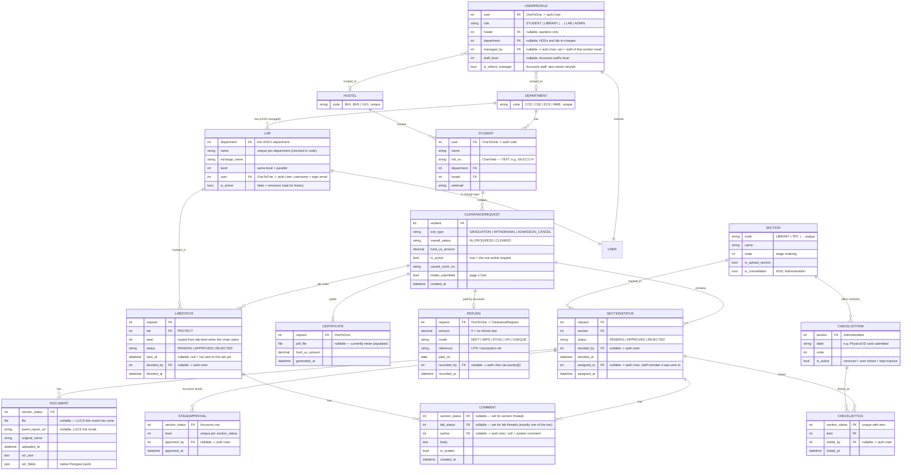

# Data Model

Source: `backend/main/models.py`. This mirrors [`DESIGN.md`](./DESIGN.md#data-models) closely — differences from that spec are called out below.

## Entity relationship diagram

## Notable implementation details vs. `DESIGN.md`

| DESIGN.md says | Code actually does | Why |
|---|---|---|
| One `ClearanceRequest` per student, full stop | `ClearanceRequest.is_active` flags the current one; `_active_request()` filters on it | Lets history (past exit attempts) stay in the table instead of being deleted |
| — | `ClearanceRequest.intake_submitted` | Not in `DESIGN.md` — added so the Library/TPC/Warden "tri-gate" works from a submitted Page 1, matching the actual multi-page frontend flow (see `docs/images/ui-wireframe.png`). (`SectionStatus.student_confirmed`, the student's per-section "Confirm & Send", was removed in migration 0013: each office now gets the request once its prerequisites approve.) |
| `Certificate.pdf_file` holds the generated PDF | Never populated — the PDF is generated **client-side** and never uploaded back to the server | Means there's no server-retained copy of an issued certificate |
| — | `Lab` + `LabStatus` (migration `0005_department_labs`) | Each department's HOD-managed lab hierarchy, gating that department's HOD — see [`DESIGN.md` § Department labs](./DESIGN.md#department-labs-hod-managed-hierarchy). Labs are deliberately **not** `Section` rows: sections are institute-wide and fixed, while labs are per-department and edited at runtime by HODs |
| — | `LabStatus.level` is a copy, not a join to `Lab.level` | The chain is copied when the student sends their first lab level, so an HOD re-levelling labs later never reshuffles a request already in progress |
| — | `Comment.section_status` became nullable; `Comment.lab_status` added | One comment table serves both section threads and lab threads. Code always sets exactly one of the two; there's no DB check constraint, to stay compatible with the `Django>=4.2` floor |
| — | `UserProfile.managed_by`, `SectionStatus.assigned_to` / `assigned_at` (migration `0006_section_staff`) | Section staff (Library, LUCS, NAD Cell, Administration): they share their head's role, and `managed_by` (the head's user) is what marks them as staff — so existing accounts, where it's empty, keep behaving exactly as before. `assigned_to` is who the head sent a request to (null = still with the head); `SET_NULL`, so a deleted staff login hands its requests back. `managed_by` is `PROTECT`: a head with staff can't be deleted by accident. See [`DESIGN.md` § Section staff](./DESIGN.md#section-staff-library-lucs-nad-cell-administration) |
| — | `UserProfile.staff_level`, `StageApproval` (migration `0007_accounts_staff_levels`) | Accounts staff work in levels. A request's current level isn't stored — it's worked out from the staff's levels and the `StageApproval` rows (one per level, `unique_together`), so moving or removing staff never strands a request. See [`DESIGN.md` § Accounts staff levels](./DESIGN.md#accounts-staff-levels) |
| — | `ChecklistItem`, `ChecklistTick` (migration `0009_administration_checklist`, which also adds Administration's "Physical ID card submitted" when the section exists) | Administration's office checklist: what each student completes in person. Its office ticks items per request, and Administration's approve is refused until every active item is ticked. Ticks survive a reopen. See [`DESIGN.md` § Administration checklist](./DESIGN.md#administration-checklist) |
| `overall_status = CLEARED` once Administration is `APPROVED` | `CLEARED` once **every** section of the request is `APPROVED` and its `Refund` is recorded (`engine.recompute_overall`) | Administration now runs alongside Accounts (both after Library/TPC/Warden/HOD), so its approval no longer implies everything else is green. Administration's staff work by hand (`SectionStatus.assigned_to`), like the Library's, LUCS's and NAD's |
| — | `Refund` (migration `0010_refund`) | Accounts' record that the student's refund was paid: amount, mode, UTR / reference, date and who recorded it. Amount 0 means no refund was due. One per request, corrected in place and never deleted, since the money can't be unsent. The request is `CLEARED`, and the certificate unlocked, only once it exists. See [`DESIGN.md` § Refund](./DESIGN.md#refund) |
| — | `UserProfile.is_refund_manager` (migration `0012_refund_manager`) | Accounts staff who also send refunds. The main account always does, whatever its own flag says, and it is always Accounts' final step after the staff levels; neither is stored, both come from it being the head (`managed_by` empty), so its `staff_level` is ignored. `0012` replaced two earlier fields: `chain_position` (`0008_head_chain_position`: the head placed `FIRST` / `LAST`, as steps 0 / 999) and `refunds_by_head` (`0011_refunds_by_head`), copying `refunds_by_head = True` into `is_refund_manager` |

## Validation invariants (enforced in `engine.py` / `api.py`, not database constraints)

- `roll_no` round-trips as text — never cast to `int` anywhere in the codebase (`DESIGN.md` Property 1).
- `(request, section)` is unique per `SectionStatus` (`Meta.unique_together`).
- A `REJECTED` `SectionStatus` always has an associated `Comment` written in the same request (`engine.reject`).
- `approve()` refuses to run unless every prerequisite section for that section is `APPROVED` (`engine.actionable`).
- Reopening any `APPROVED` section deletes the request's `Certificate` if one exists (`engine._invalidate_certificate`).
- `(request, lab)` is unique per `LabStatus` (`Meta.unique_together`).
- `approve_lab()` refuses unless the request was sent to that lab and every lower-level lab of the request is `APPROVED` (`engine.lab_actionable`); HOD's `approve()` refuses until every lab in the chain is `APPROVED` (`engine.labs_cleared`).
- A `REJECTED` `LabStatus` always has the in-charge's reason as a `Comment` written in the same transaction (`engine.reject_lab`).
- A lab leaving `APPROVED` resets every later-level `APPROVED` lab of that request, and HOD, to `PENDING` (`engine._on_lab_status_change`).
- A `Lab` referenced by any `LabStatus` can't be deleted (`PROTECT`); the HOD's "remove" deactivates it instead (`labs.remove_lab`).
- Section staff (`managed_by` set; Library, LUCS, NAD Cell, Administration) only list, review, comment on, approve or reject `SectionStatus` rows whose `assigned_to` is them (`staff.can_handle`). Bulk sends only take `PENDING`, unassigned rows of requests with `intake_submitted` whose prerequisites for that section are `APPROVED`: for LUCS / NAD the tri-gate, for Administration the tri-gate and all six departments (`staff.ready_for_staff`).
- Accounts staff act only while a request waits at their level (`staff.current_level`, over the staff levels from `staff.chain_names`); one `StageApproval` per level. Accounts becomes `APPROVED` only by `accounts@` (`decided_by` = `accounts@`): once every level has approved, or with no staff levels at all (`staff.head_can_approve`), or when it stands in for the last level, naming it (that level's `StageApproval` plus the section approval). Standing in for an earlier level is just that level's `StageApproval`, with `approved_by` = `accounts@`. A fully approved Accounts row that reopens loses its `StageApproval`s (`engine._on_status_change`).
- Administration's `APPROVED` needs a `ChecklistTick` for every active Administration `ChecklistItem` of that row (`checklist.missing`, checked in `api._decide`). Ticks are made only by someone who can decide the row (`staff.can_decide`: the head, or the staff member it was sent to), and only while it is `PENDING`.
- Store, LUCS, Sports, Medical, NAD and HOD each have the tri-gate as prerequisites: Library, Warden, and TPC when the request's exit type has a TPC row (graduation only; `engine.prerequisites(section, exit_type)`). Accounts and Administration share the same prerequisites: the tri-gate and all six departments. Every prerequisite of every exit type's sections is itself one of that exit type's sections (`engine.workflow_problems()` is empty; Django's system check `main.E001` enforces it at startup). Neither resets the other when it reopens. `overall_status` is `CLEARED` iff every `SectionStatus` of the request is `APPROVED` and a `Refund` exists for it.
- A `Refund` is recorded only for an active request whose every section is `APPROVED` (`refunds.record`). Only whoever sends refunds can record it (`refunds.can_record`): the main account (`accounts@`), always, plus Accounts staff with `is_refund_manager`. A paid one needs an amount above 0, a mode, a reference and a `paid_on` no later than the institute's (India) today. The same people may instead reject Accounts with a reason (`refunds.reject`), but only while Accounts is `APPROVED` and no `Refund` exists.

The department-lab, section-staff and Administration invariants are exercised by `main/tests.py` (`python manage.py test main`, against PostgreSQL); the others are not yet covered by an automated test suite.
