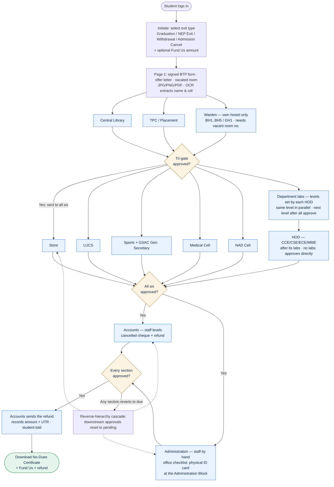
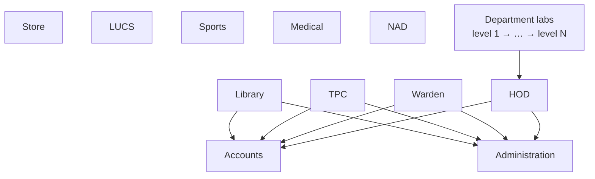
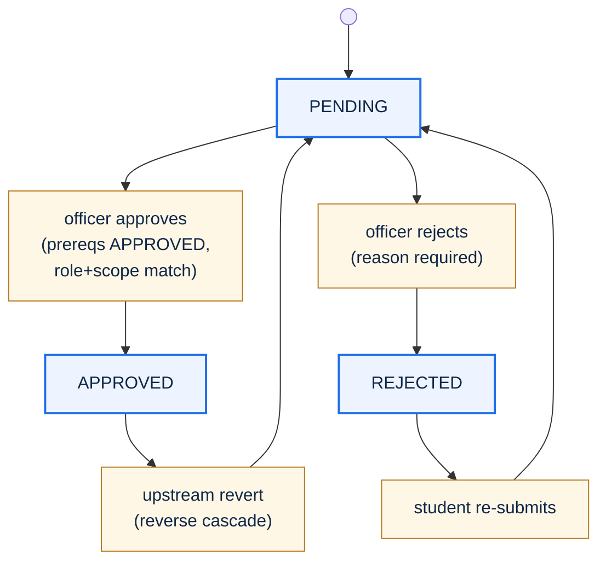
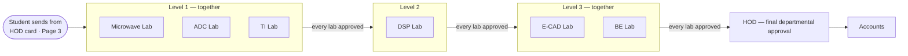
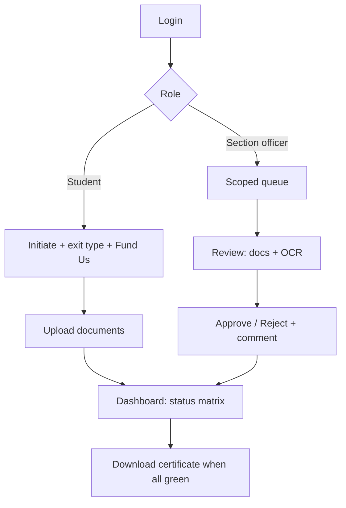

# Domain Design: LNMIIT No Dues Portal

This is the authoritative **domain design** — section flow, approval engine, routing/scoping rules, OCR pipeline, upload handling, certificate rules, and the correctness properties the implementation is expected to satisfy. It was originally written as a coordination document between the developers building this out; now that the build is done, it lives here as the lasting reference for *why the rules are what they are*, folded in alongside the rest of the documentation set.

For the system architecture (the React SPA + Django JSON API split, request lifecycle, sequence diagrams), see [`ARCHITECTURE.md`](./ARCHITECTURE.md). For the concrete model fields and how they differ from what's described here, see [`DATA_MODEL.md`](./DATA_MODEL.md).

## Overview

The LNMIIT No Dues Portal digitizes the institute's student clearance ("No Dues") process end to end. A student initiates a request, selects an exit type, uploads the proof each section requires, and every institutional section independently approves or rejects with a mandatory written reason. Approvals follow a fixed dependency hierarchy; a reverse-hierarchy cascade keeps the final status trustworthy by resetting downstream approvals when an upstream section reopens. Once every required section is cleared, the student downloads a No-Dues certificate.

On top of the fixed sections, each department's HOD maintains its own **lab hierarchy** (see [Department labs](#department-labs-hod-managed-hierarchy)). This replaces the paper "No Dues Form for Department Purpose". The student's request passes through those labs level by level before the HOD can approve, and each lab in-charge decides in the portal with a login the HOD created.

The system is purpose-built around LNMIIT's own clearance order and section responsibilities — four departments (CCE, CSE, ECE, MME), six hostels (BH1–BH5, GH1), and alphanumeric roll numbers (e.g. `24UCC174`). OCR (via `pytesseract`) is used as an advisory review aid.

**Stack**

- **Language / framework:** Python + Django (JSON API — see [`ARCHITECTURE.md`](./ARCHITECTURE.md) for the split with the React frontend), Django admin for staff data management.
- **Database:** PostgreSQL — the only supported database, in every environment (see [`SCALING.md`](./SCALING.md)).
- **OCR:** Tesseract engine via the `pytesseract` wrapper, with Pillow for image preprocessing.
- **Certificate:** generated client-side (jsPDF + html2canvas); the server supplies only the JSON payload and retains no copy of an issued certificate.
- **Auth:** Django's built-in authentication and session framework; passwords hashed by Django, never stored in plain text.

## Section Flow

The clearance follows the institute's "Order of No Dues," as three tiers that match the student's pages:

1. **Tri-gate (Page 2).** Library, TPC (graduation only) and Warden verify what the student sent on Page 1: the signed BTP form, the offer letter and the vacated room.
2. **Departments (Page 3).** Once all three have approved, the request reaches Store, LUCS, Sports, Medical, NAD and HOD **by itself**, all six at once; the student doesn't send it to each. They work side by side, and each can also see the student's Page 1 documents. HOD also waits for its department's labs when the HOD has set any up. In a department without labs, HOD approves directly.
3. **Accounts and Administration (Page 4).** They open together once all six departments have approved, and run side by side; neither waits for the other.

The request is cleared once every section has approved and Accounts has recorded the refund. The server enforces this order, not only the student's screen. Every section supports approve/reject with a mandatory reason and a two-way comment thread (omitted from the diagram for readability).



> **Department labs replace the paper department form.** The "No Dues Form for Department Purpose" ([photo](./paper-forms/department-lab-no-dues-form.jpg)) listed a department's labs (for ECE: Microwave, ADC, TI, DSP, E-CAD, BE). Each lab's in-charge signed it, then the HOD. Each HOD now keeps that list in the portal and arranges it in levels. A department with no labs set up behaves exactly as described below: HOD acts directly, once the tri-gate has approved. See [Department labs](#department-labs-hod-managed-hierarchy).

> **No "Confirm & Send".** Store, LUCS, Sports, Medical, NAD and Administration used to reach an office only after the student clicked "Confirm & Send" on that section's card. Now each gets the request by itself once its prerequisites approve: the departments after the tri-gate, Administration after the departments. Until then, the request isn't on that office's desk. After a rejection, the student sends it back with **Re-send Request** on the card (`POST /api/student/resend-section/`). The HOD card keeps its editable name / roll / department form for that.

> **HOD is independent of Store/LUCS/Sports/Medical/NAD.** All six departments wait for the same tri-gate and then work side by side. HOD used to require the other five `APPROVED` before it could act (a consolidator). That gate was removed, and later so was an informational panel of their status on HOD's review screen. HOD's review screen now only shows its own section, like the other five. Department-Purpose (a dedicated "HOD form" upload) was separately removed as a mandatory gate, and LUCS was converted from an upload section to a name/roll one like Store/Sports/Medical/NAD. If an HOD genuinely needs something from a student, they ask for it via the existing section comment thread (`main/api.py::officer_comment` / `student_comment`) rather than a blocking upload requirement.

## Components and Interfaces

### Component 1: Auth & Role/Scope Guard

**Purpose**: Enforce login on every view and verify role + scope (hostel for wardens, department for HODs) on every state-changing action.

**Responsibilities**:
- Require authentication for all portal views.
- Resolve the acting user's role and scope from their `UserProfile`.
- Reject any action where the officer's role does not match the target section, or the scope does not match the student's hostel/department.
- Re-check authorization server-side on write, independent of any queryset filtering used to build queues.

### Component 2: Approval Engine

**Purpose**: Own the per-section status matrix, enforce dependency prerequisites, and run the reverse-hierarchy cascade.

**Interface**:

```python
class ApprovalEngine:
    def actionable(self, request: ClearanceRequest, section: Section) -> bool:
        """True iff every prerequisite section of `section` is APPROVED."""

    def approve(self, section_status: SectionStatus, actor: User) -> None:
        """Set APPROVED. Requires role+scope match and all prerequisites APPROVED."""

    def reject(self, section_status: SectionStatus, actor: User, reason: str) -> None:
        """Set REJECTED. Requires a non-empty reason; writes decision + Comment atomically."""

    def on_status_change(self, section_status: SectionStatus, previous: str) -> None:
        """If transitioning away from APPROVED, reset the downstream closure to PENDING."""

    def downstream_closure(self, section: Section) -> set[Section]:
        """Transitive set of sections that depend (directly or indirectly) on `section`."""

    def recompute_overall(self, request: ClearanceRequest) -> None:
        """Set overall_status CLEARED iff every section of the request is APPROVED, else IN_PROGRESS."""

    # ── Department labs (engine.py § Department labs) ──
    def send_next_lab_level(self, request: ClearanceRequest, actor: User) -> list[LabStatus]:
        """Student: on first call copy the department's labs into the request's chain;
        send the lowest unsent level, refused while any earlier-level lab isn't APPROVED."""

    def lab_actionable(self, lab_status: LabStatus) -> bool:
        """True iff the request was sent to this lab and every earlier-level lab is APPROVED."""

    def approve_lab(self, lab_status: LabStatus, actor: User) -> None: ...
    def reject_lab(self, lab_status: LabStatus, actor: User, reason: str) -> None: ...
    def resend_lab(self, lab_status: LabStatus, actor: User) -> None:
        """Student: a REJECTED lab goes back to PENDING."""
```

**Responsibilities**:
- Guarantee an officer can only approve when prerequisites are satisfied (§ Approval Engine).
- Run the reverse cascade in the same DB transaction as the triggering change so the matrix is never left inconsistent.
- Keep `overall_status` and certificate validity consistent with the matrix.

### Component 3: OCR Service

**Purpose**: Extract text (name, roll number, and section-specific fields) from uploaded files as an advisory aid.

**Interface**:

```python
class OcrService:
    def extract(self, file_path: str) -> OcrResult:
        """Preprocess with Pillow, run pytesseract, parse expected fields."""

    def match_against_student(self, result: OcrResult, student: Student) -> list[str]:
        """Return advisory mismatch warnings (roll/name). Never raises for a mismatch."""
```

**Responsibilities**:
- Run only on eligible uploaded files (JPG/PNG/PDF within size limit).
- Produce extracted text and parsed fields for reviewer display.
- Flag mismatches as warnings only — never auto-reject. The original file remains the source of truth.

### Component 4: Upload Handler

**Purpose**: Validate and store uploads, and serve them only to authorized reviewers.

**Responsibilities**:
- Enforce type (JPG/PNG/PDF) and size limit on both client and server — **10 MB** (`main/api.py::MAX_UPLOAD_BYTES`), matching the original UI design (`docs/images/ui-wireframe.png`).
- Store originals outside the web root; serve via an access-checked download view.
- Support link-mode submission (a URL instead of a file) as a generic capability of the upload endpoint; OCR applies only when a file is provided. Not currently used by any section — LUCS was the original use case but was converted to a name/roll section (no upload at all, see the note under [Section Flow](#section-flow)).
- Always retain the original uploaded file and keep it downloadable by authorized reviewers.

### Component 5: Certificate Generator

**Purpose**: Produce the final No-Dues certificate once the request is cleared.

**Responsibilities**:
- Available only when `overall_status == CLEARED`.
- List student identity, exit type, each section with approver and timestamp, and the Fund-Us contribution.
- Be idempotent; invalidate the certificate if a reverse cascade reopens any section.

## Approval Engine

### Dependency graph

Sections are grouped into stages. A section becomes actionable only when its prerequisites are `APPROVED`.

- **Tri-gate** (`engine.TRI_GATE_SECTIONS`, no prerequisites): Library, TPC, Warden. They verify the student's Page 1.
- **Departments** (`engine.DEPARTMENT_SECTIONS`) depend on the tri-gate: Store, LUCS, Sports, Medical, NAD and HOD each wait for Library, TPC and Warden, and then work side by side; none waits for another.
- **HOD** also depends on every lab in the student's department lab chain, level by level (see [Department labs](#department-labs-hod-managed-hierarchy)). No labs set up → only the tri-gate, and HOD approves directly.
- **Accounts** depends on: the tri-gate and all six departments.
- **Administration** depends on the same as Accounts. The two run side by side, and neither waits for the other. (Administration used to come after Accounts.)
- **Reaching an office.** A `PENDING` request is listed on a section's desk only once its prerequisites have approved (`api.section_queue`), so a department sees a student only after the tri-gate, and Administration only after the departments. Accounts is the exception: `accounts@` also lists those as *Not ready yet*, with what they wait for. There is no student "Confirm & Send" for any of these sections.
- **Reverse cascade.** A section leaving `APPROVED` resets everything downstream of it. A tri-gate section reopening resets the six departments as well as Accounts and Administration; a department reopening resets Accounts and Administration.
- **Cleared** means every section of the request is `APPROVED`. No single section stands for "all green" any more (see [Final clearance](#final-clearance)).

#### Each exit type has its own graph

The sections a request goes through depend on its exit type (`engine.REQUIRED_SECTIONS`): a graduation has all eleven, while an NEP exit, a withdrawal or an admission cancel has no TPC (no placement obligation). The prerequisites follow: `engine.prerequisites(section, exit_type)` leaves out an *optional* prerequisite the exit type doesn't have (`OPTIONAL_PREREQUISITES = {TPC}`), so for those three the departments wait for **Library and Warden** only, and Accounts and Administration for Library, Warden and the six departments. `engine.workflow(exit_type)` is one exit type's whole graph, `{section: [prerequisites]}`, and everything that asks "is this section ready?" asks it of that graph:
- `actionable()` and the student's lock messages (`waiting_for`);
- the officer desk's "Waiting for …" (`stage.blocked_by`);
- Administration's "send the next N to staff" (`staff.ready_for_staff`);
- the reverse cascade (`downstream_closure(section, exit_type)`).

This fixed a real bug: before it, every exit type waited for TPC, so a student on an NEP exit, a withdrawal or an admission cancel (who has no TPC section) could never reach Accounts or Administration, and never be cleared.

**Validation — Kahn's algorithm.** `engine.analyze_workflow(graph)` runs Kahn's topological sort over a graph, in O(V + E). It repeatedly takes a section whose prerequisites are all done. It returns:
- an approval order;
- the **missing dependencies**: a prerequisite that isn't in the graph, which is the bug above;
- the sections **blocked by a cycle**: whatever the sort can never take.

`engine.workflow_problems()` runs it for every exit type, and Django's system check (`main/checks.py`, error `main.E001`) runs that before `runserver`, `migrate` and `test`. So a broken workflow stops the app from starting, rather than stranding students. Only an *optional* prerequisite may be absent from an exit type; dropping any other one (say, removing HOD from withdrawals by mistake) is reported, not silently waived. `main/tests.py` (`WorkflowGraphTests`, `ExitTypeClearanceTests`) clears a request of every exit type end to end, in the order Kahn gives.

HOD is independent of the other sections, not a consolidator — it does not wait on Store/LUCS/Sports/Medical/NAD, and doesn't display their status either; its review screen shows only its own section, plus its department's lab chain. There is no remaining link between HOD and those five sections at all. The only sections HOD gates are **Accounts** and **Administration**, the same as Library, TPC and Warden do.



`Store`, `LUCS`, `Sports`, `Medical`, `NAD` are drawn with no connection to `HOD` deliberately — there isn't one, gating or otherwise.

### Section-status state machine



### Approval rule

An officer may set a `SectionStatus` to `APPROVED` only if both hold:

1. the officer's role matches the section, and the scope matches (warden's hostel = student's hostel; HOD's department = student's department); and
2. every prerequisite section for that section is `APPROVED`.

A `REJECTED` decision requires a non-empty `Comment`; the reject action and the comment are written in a single transaction.

The same two rules apply to department labs. A lab in-charge acts only on requests the student has sent to **their own** lab. They may approve only when every lab on an earlier level of that request is `APPROVED`. Rejecting needs a reason.

### Reverse-hierarchy cascade

When a section that was `APPROVED` changes to `REJECTED` or `PENDING`, every section that transitively depends on it is reset to `PENDING`.

```python
def on_status_change(section_status, previous):
    if previous == "APPROVED" and section_status.status != "APPROVED":
        with transaction.atomic():
            for dependent in downstream_closure(section_status.section):
                ds = SectionStatus.objects.get(
                    request=section_status.request, section=dependent
                )
                if ds.status == "APPROVED":
                    ds.status = "PENDING"
                    ds.decided_by = None
                    ds.decided_at = None
                    ds.save()
                    add_system_comment(ds, f"Reset: upstream {section_status.section.code} reopened")
            section_status.request.overall_status = "IN_PROGRESS"
            section_status.request.save()
            invalidate_certificate(section_status.request)  # if one existed
```

`downstream_closure` is computed from the dependency graph. The cascade runs inside the same DB transaction as the triggering change so the matrix is never left inconsistent.

### Department labs (HOD-managed hierarchy)

The digital form of the paper "No Dues Form for Department Purpose". Code: `main/engine.py` § Department labs (approval rules), `main/labs.py` (HOD lab management), `Lab` / `LabStatus` in `main/models.py`.



- **Setting up labs (HOD → Manage labs).**
  - An HOD adds labs to their own department only. Each lab has a name, an in-charge name, a login email, a password, and a level.
  - Adding a lab also creates the in-charge's portal login: a Django `User` whose username is that email, with role `LAB`. The password must pass Django's password validators and is stored hashed.
  - The HOD can edit any of these fields, reset the password, or remove the lab.
- **Levels.** Labs that share a level number receive the request together. A higher level receives it only after **every** lab on the lower levels has approved. HOD approves after the last level. Gaps in the numbering (1, 3, …) are allowed.
- **Sending.** The student moves the request along from the HOD card on Page 3, which opens once Library/TPC/Warden approve (checked server-side too).
  - The first send copies the department's current labs into one `LabStatus` per lab, recording each lab's level at that moment, and sends level 1.
  - Each later send releases the next level, and is refused while any earlier-level lab isn't `APPROVED`.
  - A lab only sees a request once it has been sent to it.
- **HOD edits don't reshuffle students already in progress.** Because levels are copied at the first send, re-levelling, adding, or editing a lab only affects students who haven't started their lab chain yet.
- **Decisions.**
  - A lab in-charge approves ("no dues") or rejects ("dues") with a mandatory reason. Each lab has its own two-way message thread with the student.
  - A rejected lab shows its reason on the student's HOD card, and the student can **re-send** to that lab, which puts it back to `PENDING`.
- **Cascade.** If a lab leaves `APPROVED`, every `APPROVED` lab on a later level of that request resets to `PENDING`, and so does HOD. HOD's own cascade then resets Accounts/Administration and invalidates any certificate, all in one transaction. Labs on the same level are untouched. Reset labs keep their "sent" state, so they can approve again as soon as the earlier lab does.
- **Removing a lab.**
  - The lab stops blocking any in-progress request it hasn't approved yet; those rows are dropped, and a system note is added to the HOD thread.
  - Its login is disabled.
  - If no request ever involved the lab, the lab and its login are deleted outright. Otherwise it's kept as "removed", restorable from Manage labs, so past approvals stay on record.
- **No labs.** A department without labs behaves exactly as before: HOD acts directly. An HOD approval given before the department set up labs is left as it is.

### Final clearance

`overall_status` becomes `CLEARED` only when **every** section of the request is `APPROVED` **and** Accounts has recorded the student's [refund](#refund) as sent, or as not due (`engine.recompute_overall`, re-run after every decision). This used to be "Administration is `APPROVED`", which held while Administration came after Accounts. With the two side by side, an Administration approval no longer implies the rest are green. That old rule also never covered Store, LUCS, Sports, Medical or NAD once HOD stopped waiting for them. Certificate generation is gated on `CLEARED`, and any section leaving `APPROVED` invalidates an issued certificate.

### Refund

Code: `main/refunds.py`, `Refund` (one per request), and the **Refund** column of the **Approved** tab for whoever sends refunds (`components/RefundCell.tsx`).

- **When.** Once every section has approved a request, it waits for its refund. The student's Page 5 says "Every section has approved. Waiting for Accounts to send your refund of ₹…", and the certificate stays locked.
- **Who sends refunds.** `accounts@`, always: it is permanently Accounts' **refund manager**, just as it is permanently its final approver. It can also make staff members refund managers (`UserProfile.is_refund_manager`, the checkbox under **Edit** on their card); they then send refunds as well. Worked out live (`refunds.senders()`), and Manage staff shows who sends them.
- **Where.** There's no separate Refunds tab: refunds are sent from the **Approved** tab.
  - For whoever sends refunds, Approved lists **every** request Accounts has approved, not only the ones they approved themselves. The tab label shows how many are ready ("Approved (4) · 2 to send").
  - The table is cut down to the refund: the student, a **Refund** column and an **Action** column (no Stage, Status or Chat). The Refund column shows "Waiting for Store, LUCS, …" while other sections haven't approved; the bank account and a pay form (amount, mode, date, UTR) once it's ready; "Sent ₹… · UTR …"; or "No refund due".
  - The sender may open these requests (review, messages, the cancelled-cheque document) even if they never approved them, since they need the bank details to pay. Everyone else's Approved tab is unchanged.
- **Three actions.** **Mark refund sent**, **No refund due** and **Reject**. The first two are greyed out, with the reason as a tooltip, until every section has approved. **Reject** asks for a reason and sends Accounts back to the student (`refunds.reject`, then the usual rejection), e.g. when the cheque's bank details are wrong. The student fixes them and the request goes through Accounts' levels again. Reject works only while no refund is recorded.
- **Paying it.** Each ready row shows the bank account from the student's confirmed cancelled cheque, and an amount pre-filled as the ₹10,000 caution money less the Fund-Us donation; it can be changed when dues were deducted. After paying from the bank, Accounts records the amount, mode (NEFT / IMPS / RTGS / UPI / cheque), the bank's **UTR / transaction reference** and the payment date. The date can't be in the future; "today" is the institute's (India) date. Or it records **No refund due**.
- **Telling the student.** Recording it clears the request, so the certificate unlocks. The student sees a green banner on every page ("Your refund of ₹9,000.00 has been sent to your account ••••0001 by NEFT on … · UTR …"), the Refund Ledger on Page 4 shows it as paid, and a note is added to their Accounts messages. The certificate shows the refund line. There's no email (yet).
- **Corrections and reopens.** A recorded refund is never removed, since the money can't be unsent. The desk has no Correct button. A mistyped UTR is fixed in the Django admin (`Refund`), or by recording the refund again through the API, which updates the record and notes the change to the student. If a section reopens afterwards, the certificate is withdrawn as usual, and on re-approval the request clears again without a second payment.

## Routing & Scoping

### Hostel-scoped warden queues

A warden's queue is `SectionStatus` rows where `section = Warden` and `request.student.hostel == warden.hostel`. A BH1 warden can never see or act on a BH2 student's record. Enforced in the queryset **and** re-checked on every write.

### Department-scoped HOD queues

An HOD's queue is filtered by `request.student.department == hod.department`. Like the other five departments, HOD waits for the tri-gate (Library, TPC, Warden) and for none of the others (see [Approval Engine](#approval-engine)); a request isn't on its desk before then. For a department **without labs**, the request is actionable as soon as the tri-gate has approved, and the HOD approves it directly. For a department **with labs**, the HOD desk lists the request under **In labs**, with lab-by-lab progress, until every lab in its chain approves. Only then does it move to **Incoming**, with Approve enabled. The server refuses an early approve either way.

### Lab in-charge queues

A lab login is tied to exactly one lab (`Lab.user`), so the lab, and with it the department, always comes from the session, never from the request body. Its queue holds only active requests that a student has **sent** to that lab. Approve is disabled while an earlier-level lab of that request isn't approved. Lab logins can't reach the section endpoints, and section officers can't reach the lab endpoints.

### Section staff (Library, LUCS, NAD Cell, Administration)

Code: `main/staff.py`, enabled through `STAFF_SECTIONS = [LIBRARY, LUCS, NAD, ACCOUNTS, ADMINISTRATION]`. Adding another section code there is all that's needed to extend it. Library, LUCS, NAD Cell and Administration work **by hand**, as described below. Accounts works **by level**; see the next section.

- **Head.** Each of those sections' own account — `library@`, `lucs@`, `nad@`, `admin.office@` — is its **head**: its `UserProfile.managed_by` is empty. Every request reaches the head first, exactly as before.
- **Staff.** The head adds staff in **Manage staff**. Each staff member gets a login with the **same role** as the head (`LIBRARY` / `LUCS` / `NAD` / `ADMINISTRATION`), so they sign in as that section. Their profile records the head in `managed_by`, and the password goes through Django's validators. Each head sees and manages only its own staff.
- **Sending work.** The head records who handles a request in `SectionStatus.assigned_to`. Two ways to set it:
  - **"Send the next N waiting requests to …"** takes the oldest unassigned `PENDING` requests that the student has fully submitted. That means Page 1 is submitted (`intake_submitted`) and, for a section that waits on others (LUCS and NAD: the tri-gate; Administration: the tri-gate and all six departments), those have approved, so staff only receive requests they can act on. Locking with skip-locked means two simultaneous sends never pick the same request.
  - **The per-row "Handled by" menu** moves one request, or takes it back to the head.
- **What staff can do.** A staff member's queue, review, approve/reject, and comments cover **only** requests sent to them. Anything else answers `403`. That includes documents: Administration's head can open any section's documents, but its staff only those of requests sent to them.
  - Their decision is **final** for that section and is recorded as `decided_by = the staff member`, so the records show who approved (the certificate itself just says "Approved").
  - The head can still decide any request directly.
- **Re-submission.** If a student re-submits after a staff rejection, the request stays with the same staff member.
- **Removing staff.** Removing a staff member hands everything they hadn't approved back to the head and disables their login. If they never handled anything, the login is deleted. Otherwise it's kept (restorable), so their past decisions still show who made them.
- **Head-only actions.** Only the head can manage staff or send work. Staff never see the Manage staff tab or the send controls.

### Accounts staff levels

Code: `main/staff.py` (`LEVELLED_SECTIONS = [ACCOUNTS]`), `UserProfile.staff_level` (staff only), `StageApproval`.

```mermaid
flowchart LR
    R([Request ready for Accounts<br/>Library · TPC · Warden + six departments approved<br/>+ cheque details confirmed]) --> L1[Level 1<br/>Clerk]
    L1 -->|approves| L2[Level 2<br/>Assistant A or B]
    L2 -->|either approves| L3[Level 3<br/>Officer]
    L3 -->|approves| H[accounts@<br/>final approval]
    H -->|approves| OK([Accounts APPROVED])
```

- **Setting it up.** `accounts@` adds staff in **Manage staff**, the same way as the by-hand sections, but each person also gets a **level**. Several people can share a level.
- **When a request is ready.** A request is ready for the levels once it's `PENDING` and actionable: Library, TPC, Warden and all six departments are approved, and the student's latest Accounts submission (the cancelled-cheque details) is confirmed. Until then it waits with `accounts@`, and the desk says why.
- **Moving up.** A ready request waits at the **lowest level that hasn't approved it yet**, and everyone on that level sees it. When **either** of them approves, one `StageApproval` is recorded for that level and the request moves up.
  - The current level is worked out live from the staff the head has now. A level with nobody on it is skipped, and nothing is stranded when people are moved or removed.
- **The final step is always `accounts@`.** After the last level approves, the request is not yet approved: it comes to `accounts@` (`stage.final`), and **its approval approves Accounts**, with `decided_by` = `accounts@`. This is fixed: the head is never on a staff level (`staff.level_names()` lists staff only; a `staff_level` left on its own profile is ignored), and there's no setting to move it. Manage staff shows it after the last level as **Final approval** ("You (main account) · Refund manager", with how many requests wait for it). With no staff levels at all, every ready request comes straight to it.
- **Rejections.** Any level can reject, and a reason is required. The student fixes the details and confirms again. The request then returns to **the level that rejected it**, because earlier levels' approvals are kept.
- **Re-check after a reopen.** If an Accounts row that was fully approved reopens, its level approvals are cleared and it starts again from level 1. That happens either through the reverse cascade (e.g. Library reopens) or when `accounts@` rejects it after approval.
- **The head.** `accounts@` sees every request with its stage: for example "Level 2 of 3 · Assistant A / B", "With you · final approval", or "Not ready yet" plus the reason. Its **Show** filter has "With you · final approval", one entry per configured level ("At Level 1 (4)", "At Level 2 (3)", …), and "Not ready yet", each with a count.
  - Every Incoming row has an **Approve** button. On a request every level has approved, it is the head's final approval. On a request still at a level, the head approves that level, standing in for the people on it: that is recorded as the level's `StageApproval`, with the head as approver, and moves the request up exactly one level, so no level is ever skipped. At the last level, the head's step comes next anyway, so standing in there is also its final approval, in one click.
  - When standing in, the desk sends the level shown on screen (`level`). If the request has moved on meanwhile, even to the head's own final step, the server refuses with `409` instead of approving a step further. An approve without `level` only gives the final approval.
  - *Not ready yet* rows show Approve greyed out with the reason: the earlier sections still pending (`stage.blocked_by`, e.g. "Waiting for Library, TPC, Warden, Store, LUCS, Sports, Medical, NAD, HOD"), or the student's cheque details. The server refuses with `409` and the same reason.
  - The head can always **Reject**, which sends the request back to the student. There's no "send" bar for Accounts: requests aren't sent by hand.
- **What staff see.** Staff see the requests at their level (**Incoming**), plus those they approved a level of (**Approved**) or rejected (**Rejected**). They can open a request's documents only once it has reached them, which matters because these are bank details.
- **What the student sees.** Just the Accounts card's status, as for any section; the levels stay internal. The certificate lists each level as "Approved" with its date; who approved stays in the records.

### Administration checklist

Code: `main/checklist.py`, `ChecklistItem` / `ChecklistTick`, enabled through `CHECKLIST_SECTIONS = [ADMINISTRATION]`.

- **What it is.** A list of things every student must complete in person at the Administration office, starting with **"Physical ID card submitted"**. `admin.office@` manages the list under **Manage staff → Checklist at the office**. An item that was ever ticked is kept, inactive, when removed, so past ticks stay on record.
- **Ticking.** The office ticks each item on the request, in the **Checklist** column of Incoming, when the student hands it in. Whoever can decide the request can tick it: the head, or the staff member it was sent to. Only while the request is `PENDING`.
- **The gate.** Approve is refused (`409`, naming the missing items), for the head and staff alike, until every active item is ticked. A new item applies to requests already in progress. Ticks survive a reopen: what was handed in stays handed in.
- **The student** sees the checklist on Page 4, under Administration and beside Accounts ("Complete at the Administration office", at the Administration Block, LNMIIT), with each item marked received or pending.

### Officer visibility

Each officer sees only rows for their own section (and scope). This is a queryset-level filter plus a per-action authorization check. Administration's review still shows every other section's documents and status, as context for its sign-off. It no longer waits for all of them, since it runs alongside Accounts; the certificate does instead (see [Final clearance](#final-clearance)).

### Exit-type rules

`exit_type` determines the required section set for a request. Graduation uses the full set; NEP Exit, Withdrawal, and Admission Cancel omit TPC (no placement obligation applies). The required set is resolved once at request creation, and one `SectionStatus` row is created per required section.

## OCR Pipeline

On upload to an upload-enabled section:

```python
def process_upload(uploaded_file, section_status, student):
    # 1. Validate: type in {jpg, png, pdf}, size within limit — else reject.
    validate_upload(uploaded_file)

    # 2. Store original outside web root (always retained).
    path = store_secure(uploaded_file)

    # 3. Preprocess with Pillow (grayscale, light denoise/threshold).
    # 4. Run pytesseract.image_to_string() -> ocr_text.
    # 5. Parse expected fields (name, roll_no, NAD id, ...) -> ocr_fields (JSON).
    result = ocr_service.extract(path)

    # 6. Compare parsed roll_no/name against the student record; flag mismatches (advisory).
    warnings = ocr_service.match_against_student(result, student)

    Document.objects.create(
        section_status=section_status, file=path,
        ocr_text=result.text, ocr_fields=result.fields,
    )
    return warnings  # shown to reviewer; never auto-rejects
```

- The officer UI shows the extracted fields **and** a download link to the original.
- OCR is advisory: a mismatch raises a warning; it does not auto-reject. The original file is the source of truth.
- In practice this degrades to a no-op if Tesseract isn't installed on the machine running Django.

## Upload Handling

- **Limit:** **10 MB** (`main/api.py::MAX_UPLOAD_BYTES`), enforced both client-side (pre-check) and server-side (hard validation).
- **Types:** JPG, PNG, PDF.
- **Quality guidance:** the upload control advises submitting the highest quality that fits the limit; files too degraded for OCR are flagged.
- **Link mode:** the upload endpoint generically also accepts a URL instead of a file (originally used by LUCS; no section currently uses it — see [Section Flow](#section-flow)); OCR applies only when a file is provided.
- **Storage:** files stored outside the web root; served to authorized reviewers through an access-checked download view, not by direct static URL.

## Certificate & Fund Us

- When `overall_status == CLEARED`, a "Download Certificate" action produces a document listing the student, exit type, and every section with its approver and timestamp.
- The student sets the optional **Fund-Us** donation on Page 4 (Financial), beside the Refund Ledger: ₹0 up to the ₹10,000 caution money it comes out of. It can change until Accounts approves or the refund is recorded (`refunds.set_donation` locks the Accounts row and the request, so an approval can't slip in between). Accounts deducts it from the refund, and it appears on the certificate and the refund ledger.
- Certificate generation is idempotent and is invalidated if a reverse cascade reopens any section.

## Screen Flow & Routes

| Route | Role | Purpose |
|---|---|---|
| `/login` | all | Role-based login |
| `/student/initiate` | Student | Select exit type |
| `/student/upload` | Student | Upload per-section documents (Library, TPC, Accounts) |
| `/student/dashboard` | Student | Per-section status matrix, comments, re-upload, certificate |
| `/section/<code>/queue` | Section officer | Scoped queue of pending requests |
| `/section/<code>/review/<id>` | Section officer | View docs + OCR, approve/reject with comment |
| `/hod/queue` | HOD | Department-scoped consolidated queue (Incoming · **In labs** · Approved · Rejected) |
| HOD desk → **Manage labs** | HOD | Add / edit / re-level / remove the department's labs; creates each in-charge's login |
| Lab desk (user type **Lab In-charge**) | Lab in-charge | Requests sent to this lab: approve, reject with reason, message the student |
| Library / LUCS / NAD Cell desk (head: `library@`, `lucs@`, `nad@`) | Section head | Every request; **Send the next N** to a staff member; per-row **Handled by**; **Manage staff** tab |
| Same desk (staff, same user type as the head) | Section staff | Only the requests their head sent them; approve / reject (final) |
| Accounts desk (head, `accounts@`) | Accounts head | Every request with its **Stage** (level N of M); **Manage staff** with levels |
| Accounts desk (staff, user type **Accounts**) | Accounts staff | Requests waiting at their level; approve (moves it up) / reject |
| `/accounts/queue` | Accounts | Refund + cancelled-cheque review |
| `/admin-office/queue` | Administration | Final all-green approval |
| `/certificate/<id>` | Student | Download final certificate |



## Access Control & Security

- Every view is login-required and role-guarded; every state-changing action re-verifies role **and** scope (hostel/department) server-side.
- CSRF protection on all forms (Django default); template auto-escaping for XSS; ORM parameterization against SQL injection.
- Uploaded files are access-checked on download; sensitive fields (bank details, cancelled cheque) are visible only to Accounts and Administration.
- All approval/rejection actions and reverse-cascade resets are recorded with actor and timestamp for an audit trail.
- An HOD manages only their own department's labs; another department's lab id answers 404. Lab passwords go through Django's password validators and are stored hashed; the API never returns them. Removing a lab disables its login.
- A lab in-charge sees and acts only on requests sent to their own lab. They get a read-only overview of that request's lab chain, but no documents and no other section's data.
- Section staff (Library, LUCS, NAD Cell) see and act only on requests their head sent them, and can't manage staff or move requests. Only the head (`library@`, `lucs@`, `nad@`) can do those, on its own staff (another head's staff id is a 404).

## Correctness Properties

These properties are stated for property-based testing (e.g. Hypothesis). Each should hold for all valid inputs over the domain described. **Example-based tests in `main/tests.py` cover P13–P24 (department labs, section staff, Accounts levels, Accounts and Administration side by side, the checklist, refunds), and P8.** Through the lab cascade they also cover the HOD → Accounts → Administration reset and the certificate invalidation of P4/P9. P1–P12 are otherwise not yet covered by an automated test.

### Property 1: Roll number is always text

For any student, `roll_no` is stored and retrieved as a string and round-trips unchanged, including values with leading digits and embedded letters (e.g. `24UCC174`).

```python
# for all valid roll strings r drawn from the LNMIIT pattern:
assert isinstance(student.roll_no, str)
assert Student.objects.get(pk=student.pk).roll_no == r
```

### Property 2: Prerequisite gating (no out-of-order approval)

For any request and any section `s`, if some prerequisite of `s` is not `APPROVED`, then `approve(s)` is rejected and the status of `s` stays unchanged.

```python
# for all requests, all sections s, all officers with matching role+scope:
if not all(prereq.status == "APPROVED" for prereq in prerequisites(s)):
    with pytest.raises(PermissionError):
        engine.approve(section_status(request, s), officer)
```

### Property 3: Reverse-cascade consistency

After any sequence of approvals/rejections, the matrix satisfies: no section is `APPROVED` while any of its prerequisites is not `APPROVED`.

```python
# invariant that must hold after every operation:
for req in ClearanceRequest.objects.all():
    for ss in req.sectionstatus_set.filter(status="APPROVED"):
        assert all(p.status == "APPROVED" for p in prerequisites(ss.section))
```

### Property 4: Cascade completeness

If an `APPROVED` section transitions away from `APPROVED`, then every section in its transitive downstream closure that was `APPROVED` becomes `PENDING`.

```python
before = {d: status(d) for d in downstream_closure(s)}
engine.reject(section_status(request, s), officer, reason="...")
for d in downstream_closure(s):
    if before[d] == "APPROVED":
        assert status(d) == "PENDING"
```

### Property 5: Hostel scoping

For any warden action, the target request's student hostel equals the warden's hostel; otherwise the action is denied. No warden query ever returns a student from another hostel.

```python
# for all wardens w, all warden-section rows visible to w:
assert row.request.student.hostel == w.profile.hostel
# and a cross-hostel write is always denied:
with pytest.raises(PermissionError):
    engine.approve(other_hostel_row, w)
```

### Property 6: Department scoping

For any HOD action, the target request's student department equals the HOD's department; otherwise the action is denied. No HOD query returns a student from another department.

### Property 7: Rejection requires a reason

Every `REJECTED` `SectionStatus` has at least one non-empty `Comment` authored in the same transaction. A reject call with empty/whitespace reason leaves the status unchanged.

```python
with pytest.raises(ValidationError):
    engine.reject(section_status, officer, reason="   ")
assert section_status.status != "REJECTED"
```

### Property 8: Certificate gating

A certificate exists for a request only if `overall_status == CLEARED`. That holds only if every required section, Accounts and Administration included, is `APPROVED`, and Accounts has recorded the refund (sent, or not due).

```python
if Certificate.objects.filter(request=req).exists():
    assert req.overall_status == "CLEARED"
    assert all(ss.status == "APPROVED" for ss in required_sections(req))
    assert Refund.objects.filter(request=req).exists()
```

### Property 9: Certificate invalidation on reopen

If a reverse cascade reopens any section on a request that had a certificate, the certificate is invalidated and `overall_status` returns to `IN_PROGRESS`.

### Property 10: OCR is advisory only

For any upload with an OCR name/roll mismatch, the section status is never changed automatically; the original file remains stored and downloadable.

```python
warnings = process_upload(bad_scan, section_status, student)
assert warnings != []                      # mismatch flagged
assert section_status.status == "PENDING"  # never auto-rejected
assert Document.objects.get(section_status=section_status).file  # original retained
```

### Property 11: Upload validation

Any file exceeding the configured size limit or of a disallowed type is rejected and no `Document` is created; any accepted file is exactly one of JPG/PNG/PDF and within the limit.

### Property 12: Single active request

At most one active `ClearanceRequest` exists per student at any time; re-initiation while one is active is blocked.

### Property 13: Lab level gating

For any request and lab `l`, `approve_lab(l)` succeeds only if the request was sent to `l` and every lab of that request on a lower level is `APPROVED`. Otherwise it is refused and `l`'s status is unchanged. Likewise, the student can send level N only once every lab below N is `APPROVED`.

```python
if any(o.status != "APPROVED" for o in chain(request) if o.level < l.level):
    with pytest.raises(PermissionError):
        engine.approve_lab(l, l.lab.user)
```

### Property 14: HOD waits for its department's labs

`approve(HOD)` is refused while any lab in the request's chain is not `APPROVED`. It is also refused before the chain has started, if the student's department has labs.

### Property 15: Lab cascade

If an `APPROVED` lab leaves `APPROVED`, every `APPROVED` lab on a later level of the same request becomes `PENDING`, and so does HOD. Through HOD, Accounts/Administration reset too, and the certificate is invalidated. Labs on the same level are untouched.

### Property 16: In-progress chains are stable

Once a student has sent their first lab level, later HOD changes to lab levels, or added labs, never change that request's chain. The one exception is removing a lab, which drops it from chains it hadn't approved yet.

### Property 17: Lab scoping

A lab in-charge's queue and actions cover only requests sent to their own lab. An HOD can view and change only their own department's labs.

### Property 18: Section staff act only on what they were sent

For any staff member `s` of a section `X` (Library, LUCS, NAD Cell) and request `r`, the following succeed only if `r`'s `X` row is assigned to `s`: listing `r` in `s`'s queue, reviewing it, commenting on it, approving it, and rejecting it. Otherwise each is refused and the row is unchanged. Only `X`'s head can assign, move, or take back requests, or manage its own staff.

### Property 19: Bulk send takes the oldest ready requests

"Send the next N to `s`" assigns `min(N, waiting)` requests to `s`. It takes the oldest rows of the head's section that are `PENDING`, unassigned, on a request whose Page 1 is submitted, and whose prerequisites for that section have approved. It never assigns any other row.

### Property 20: Accounts levels in order, one approval per level

A ready Accounts request is decidable by a staff member `s` only while it waits at `s`'s level. That level is the lowest staff level without a `StageApproval`, where the levels are those with an active staff member on them (never the head). Each level records at most one approval, and anyone on it may give it. Accounts becomes `APPROVED` only through `accounts@`, the final step: once every level has approved (or straight away with no staff levels), or when it stands in for the last level, which is also its final approval. Before that, `accounts@` may approve the level a request waits at by naming that level; that is the one level's approval, so no level is skipped. A staff member's approval never approves the section while the main account exists.

### Property 21: Levels re-check after a reopen, resume after a rejection

If a fully approved Accounts row leaves `APPROVED`, its `StageApproval`s are deleted, so it restarts at level 1. A rejection made while the request is still in progress keeps the earlier levels' approvals, so after the student's fix the request resumes at the rejecting level.

### Property 22: Accounts and Administration side by side

For any request, Accounts and Administration are actionable under the same condition: Library, Warden, Store, LUCS, Sports, Medical, NAD and HOD `APPROVED`, plus TPC when the request's exit type has it (graduation). Neither section's status affects the other's actionability, and Accounts leaving `APPROVED` does not reset Administration (or vice versa). Either one leaving `APPROVED` still invalidates the certificate, since `CLEARED` needs every section.

### Property 22a: Every exit type can be cleared

For every exit type, `engine.workflow(exit_type)` is a DAG with no missing dependencies: Kahn's algorithm orders all of its sections, and every prerequisite of a section is itself a section of that exit type. Hence a request of any exit type can reach `CLEARED`, and each section is actionable exactly when its prerequisites for that exit type are `APPROVED` (`main/tests.py::ExitTypeClearanceTests`; checked at startup by `main/checks.py`).

### Property 23: Administration's checklist gates its approval

An approve of a request's Administration row, by the head or its staff, succeeds only if every active `ChecklistItem` of Administration has a `ChecklistTick` for that row. Only someone who can decide the row may tick it, and only while it is `PENDING`.

### Property 24: The refund comes before the certificate

A refund can be recorded only for an active request whose every section is `APPROVED`. Only whoever sends refunds can record it: the Accounts staff on the last level, or `accounts@` if it took this over or has no staff levels. A paid refund needs an amount above zero, a mode, a UTR / reference and a date no later than the institute's today. Recording it, or "no refund due", is what turns an all-approved request `CLEARED`. There is at most one `Refund` per request: a correction updates it, and a reopen never asks for a second payment.

## Error Handling

### Duplicate active request

**Condition**: Student initiates while an active request exists.
**Response**: Initiation blocked with a clear message.
**Recovery**: Student continues the existing request from the dashboard.

### Out-of-order approval attempt

**Condition**: Officer tries to approve before prerequisites are `APPROVED`.
**Response**: Denied by the prerequisite check; status unchanged.
**Recovery**: Officer acts once upstream sections clear.

### Certificate issued then upstream reopened

**Condition**: An upstream section reverts after a certificate was generated.
**Response**: Reverse cascade resets downstream to `PENDING`, invalidates the certificate, sets `overall_status = IN_PROGRESS`.
**Recovery**: Sections re-approve; certificate regenerates when cleared again.

### Oversized or unreadable upload

**Condition**: File over the size limit, wrong type, or too degraded for OCR.
**Response**: Oversized/wrong-type files rejected at validation with a clear message; degraded-but-valid files accepted with an OCR-quality warning (not an auto-reject).
**Recovery**: Student re-uploads a compliant file.

### Wrong-hostel / wrong-department access

**Condition**: Officer attempts to view or act on an out-of-scope record (even via a guessed URL).
**Response**: Denied by the server-side scope check.
**Recovery**: None needed; action is refused and auditable.

## Testing Strategy

### Unit Testing Approach

- Model validation: `roll_no` as text, enum constraints, `(request, section)` uniqueness, rejection-requires-comment invariant.
- Approval engine: prerequisite gating, approve/reject transitions, `downstream_closure` correctness, `recompute_overall`.
- Upload validation: size/type limits on client and server paths.
- OCR service: field parsing and advisory matching (with fixed sample images).

### Property-Based Testing Approach

Encode the Correctness Properties (P1–P12) as properties over randomized operation sequences and student/section data.

**Property Test Library**: Hypothesis (Python).

Focus areas: hierarchy invariants (P2–P4), scoping (P5–P6), certificate gating/invalidation (P8–P9), roll-number-as-text (P1), and upload validation (P11).

### Integration Testing Approach

- End-to-end clearance for each exit type: initiate → upload → parallel section approvals (including HOD, independent) → Accounts → Administration → certificate download. Implemented in `ExitTypeClearanceTests`: every exit type, approvals in Kahn's order through the API, each section's `actionable` checked at every step, then a reopen and re-clear.
- Reverse-cascade scenario: clear through Administration, reopen an upstream section, assert downstream reset and certificate invalidation.
- Access-control scenarios: cross-hostel and cross-department attempts via direct URLs; unauthorized document download attempts.

## Security Considerations

- Login required on every view; role + scope re-verified server-side on every state-changing action.
- Django defaults for CSRF, XSS (template auto-escaping), and SQL injection (ORM parameterization).
- Documents stored outside web root and served only through an access-checked download view.
- Sensitive financial data (bank details, cancelled cheque) restricted to Accounts and Administration.
- Full audit trail: actor + timestamp on every decision and every reverse-cascade reset.

## Dependencies

- **Django** — web framework, ORM, auth, admin, CSRF/XSS/SQLi protections.
- **pytesseract** + **Tesseract OCR engine** — advisory text extraction from uploads.
- **Pillow** — image preprocessing for OCR.
- **jsPDF + html2canvas** — client-side certificate PDF generation.
- **Database**: PostgreSQL — the only supported database, in every environment (see [`SCALING.md`](./SCALING.md)).

## Implementation Notes (non-negotiable)

- Store `roll_no` as text, never integer.
- No cross-hostel or cross-department visibility.
- No department (Store, LUCS, Sports, Medical, NAD, HOD) approval before the tri-gate (Library, TPC, Warden) has approved; the six don't wait for each other. No Accounts or Administration approval before all six have approved. Enforced by the server, not only the student's pages.
- No HOD approval before every lab in the student's department lab chain has approved; lab levels open strictly in order.
- Section staff (Library, LUCS, NAD Cell) never see or decide a request their head didn't send them; only the head manages staff.
- Accounts staff act only at their own level; Accounts is approved only by the last staffed level — `accounts@` never approves over its staff.
- No rejection without a written reason.
- OCR never replaces the original document; originals remain downloadable.
